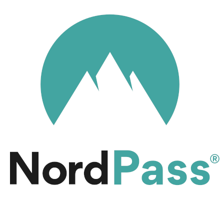
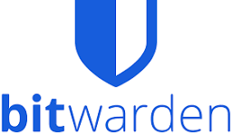
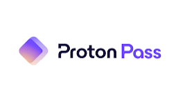

---

marp: true
theme: default
class: paginate
style: |
  /* Farbenfrohes Cyberpunk-Hacker-Theme */
  section {
    background-color: #090514 !important; /* Dunkles Cyber-Violett */
    color: #39FF14; /* Giftgrüner Terminal-Text */
    font-family: 'Courier New', Courier, monospace;
    text-shadow: 0 0 6px rgba(57, 255, 20, 0.4);
  }
  
  /* Überschriften */
  section h1 {
    color: #00F0FF; /* Neon-Cyan/Türkis für Titel */
    font-size: 2.5rem;
    border-bottom: 2px dashed #00F0FF;
    padding-bottom: 10px;
    text-shadow: 0 0 12px rgba(0, 240, 255, 0.8);
  }
  section h3 {
    color: #FF007F; /* Neon-Pink für Untertitel */
    text-shadow: 0 0 8px rgba(255, 0, 127, 0.6);
  }
  
  /* Listen-Styling */
  section ol {
    font-size: 1.5rem;
    font-weight: bold;
    color: #00F0FF;
    text-shadow: 0 0 8px rgba(0, 240, 255, 0.6);
  }
  section ul {
    font-size: 1.3rem;
    font-weight: bold;
    list-style-type: '> ';
  }
  
  /* Alles Fettgedruckte in Neon-Pink */
  section strong {
    color: #FF007F !important;
    text-shadow: 0 0 10px rgba(255, 0, 127, 0.85) !important;
  }

  /* Cyber-Grid Tabelle */
  section table {
    width: 100%;
    border-collapse: collapse;
    margin-top: 1rem;
    font-size: 1.1rem;
    background-color: #090514 !important;
    border: 2px solid #00F0FF !important; /* Türkiser Rahmen */
    box-shadow: 0 0 15px rgba(0, 240, 255, 0.2);
  }
  section th {
    background-color: #120a26 !important;
    color: #00F0FF !important;
    font-weight: bold;
    padding: 12px;
    border-bottom: 2px solid #00F0FF !important;
    border-right: 1px solid #00F0FF !important;
    text-shadow: 0 0 8px rgba(0, 240, 255, 0.7);
  }
  section td {
    padding: 12px;
    color: #39FF14 !important;
    background-color: #090514 !important;
    border-bottom: 1px solid #1a0f38 !important;
    border-right: 1px solid #00F0FF !important;
  }
  
  section th:last-child, section td:last-child {
    border-right: none !important;
  }
  
  section td strong {
    color: #FF007F !important;
    text-shadow: 0 0 10px rgba(255, 0, 127, 0.85) !important;
  }
  
  section tr:nth-child(even) {
    background-color: #120a26 !important; /* Leicht helleres Violett */
  }

  /* Farbige Terminal-Boxen */
  .columns {
    display: grid;
    grid-template-columns: repeat(3, minmax(0, 1fr));
    gap: 0.6rem;
    margin-top: 0.8rem;
    width: 100%;
  }
  .column-box {
    border: 1px solid #FF007F; /* Pinker Rahmen für Boxen */
    padding: 0.6rem;
    background: #0d071f;
    box-shadow: 0 0 10px rgba(255, 0, 127, 0.2);
    text-align: center;
    box-sizing: border-box;
    display: flex;
    flex-direction: column;
    justify-content: space-between;
  }
  .column-box img {
    max-width: 65px;
    height: auto;
    margin: 0.3rem auto 0 auto !important;
  }
  .column-box h3 {
    font-size: 1.2rem;
    margin-bottom: 0.3rem;
  }

  .compact {
    font-size: 1.1rem;
    line-height: 1.3;
    display: block;
    margin-bottom: 0.3rem;
    color: #39FF14;
  }
  
---

# [SYS_INIT]: Passwort-Manager Vergleich
### root@cyber_terminal:~# NordPass, Bitwarden & Proton Pass
<!-- [Folie 1: Passwort-Manager Vergleich] -->
<!--
[SPRECHTEXT]
Hey! Heute vergleiche ich NordPass, Bitwarden und Proton Pass. Viele Leute benutzen immer noch unsichere Passwörter, und genau deshalb sind Passwortmanager so wichtig. In dieser Präsentation schauen wir uns an, wie die drei Anbieter das Problem lösen und wo die wichtigsten Unterschiede liegen.
-->

---

# [FETCH_REPOS]:  .//Anbieter im Überblick

<h3>01_NordPass</h3>
 

<h3>02_Bitwarden</h3>
 

<h3>03_Proton_Pass</h3>
 

<!-- [Folie 2: Anbieter im Überblick] -->
<!--
[SPRECHTEXT]
So sieht die Auswahl aus: NordPass kommt von NordVPN, Bitwarden ist der bekannte Open-Source-Standard und Proton Pass ist eher ein Datenschutz-Tool aus der Schweiz. Alle drei haben zwar ähnliche Ziele, aber ziemlich unterschiedliche Ideen, wie sie das umsetzen.
-->

---

# [ANALYSIS]: Vergleichskriterien

- **Sicherheit & Verschlüsselung** ── [CRYPT_LOG]
- **Kosten & Tarife** ────────────── [PRICING_DEPT]
- **Komfort &amp; Plattformen** ──────── [UI_UX_LAYER]

<!-- [Folie 3: Vergleichskriterien] -->
<!--
[SPRECHTEXT]
Ich vergleiche die Anbieter anhand von drei Dingen: Sicherheit, Kosten und wie einfach sie im Alltag zu benutzen sind. Dabei geht es vor allem darum, was wirklich wichtig ist, wenn man einen Passwortmanager langfristig nutzen will.
-->

---

# [DATA_GRID]: Kernstärken

| Manager | Stärke | Feature | Krypto |
| :--- | :--- | :--- | :--- |
| **Bitwarden** | Preis-Leistung | Open Source & Self-Hosting | AES-256 |
| **Proton Pass** | Datenschutz | E-Mail-Aliasse | Argon2 & AES |
| **NordPass** | Bedienung | Intuitive UI | XChaCha20 |

<!-- [Folie 4: Kernstärken] -->
<!--
[SPRECHTEXT]
Hier sieht man die wichtigsten Stärken auf einen Blick: Bitwarden ist super für Preis-Leistung und Self-Hosting, Proton Pass punktet mit Datenschutz und Mail-Aliassen und NordPass ist besonders einfach und angenehm zu bedienen.
-->

---

# [SEC_CHECK]:  Kriterium 1: Sicherheit

- **Zero-Knowledge:** Keinerlei Klartext-Einsicht durch Anbieter
- **Bitwarden & Proton Pass:** Standardisierte **AES-256-Verschlüsselung**
- **NordPass:** Moderner, performanter **XChaCha20-Algorithmus**

<!-- [Folie 5: Kriterium 1: Sicherheit] -->
<!--
[SPRECHTEXT]
Beim Thema Sicherheit sind alle drei relativ gut aufgestellt. Sie arbeiten mit Zero-Knowledge, also ohne dass der Anbieter die Passwörter direkt einsehen kann. Bitwarden und Proton Pass benutzen AES-256, und NordPass setzt auf XChaCha20, was besonders schnell und modern ist.
-->

---

# [COST_LAYER]:  Kriterium 2: Kosten

- **Bitwarden:** Bester **Free-Tarif** (unlimitierte Geräte & Passwörter)
- **Proton Pass:** Unlimitierte Geräte, aber Limit bei Mail-Aliassen
- **NordPass Free:** Stark restriktiv (nur **1 aktives Gerät** gleichzeitig)

<!-- [Folie 6: Kriterium 2: Kosten] -->
<!--
[SPRECHTEXT]
Bei den Preisen gibt es ziemlich große Unterschiede. Bitwarden hat die beste Gratisversion, Proton Pass ist auch okay, aber mit kleinen Einschränkungen. NordPass Free ist dagegen ziemlich eingeschränkt, weil man dort nur ein Gerät gleichzeitig nutzen kann.
-->

---

# [UI_EFFICIENCY]: Kriterium 3: Komfort

- **Plattformen:** Apps für Mobile & alle gängigen Browser-Erweiterungen
- **Autofill & Passkeys:** Biometrischer Login & moderne **Passkey-Verwaltung**

<!-- [Folie 7: Kriterium 3: Komfort] -->
<!--
[SPRECHTEXT]
Im Alltag sind alle drei recht leicht nutzbar. Sie haben Apps für Handy und Browser und unterstützen Autofill sowie Passkeys. Das macht die Anmeldung einfach und deutlich sicherer, weil man nicht ständig Passwörter selbst eintippen muss.
-->

---

# [MASK_ING]:  Feature: E-Mail-Aliasse

- **Proton Pass:** Native **"Hide-my-Email"-Funktion** (Spamschutz)
- **NordPass:** E-Mail-Masking nur in **Premium-Tarifen** verfügbar
- **Bitwarden:** Nur über externe Drittanbieter-Dienste koppelbar

<!-- [Folie 8: Feature: E-Mail-Aliasse] -->
<!--
[SPRECHTEXT]
Ein cooles Extra ist die E-Mail-Alias-Funktion. Damit kann man für Websites zufällige E-Mail-Adressen nutzen und so Spam vermeiden. Proton Pass bietet das direkt an, bei NordPass ist das nur mit Premium und bei Bitwarden braucht man dafür oft externe Tools.
-->

---

# [AUDIT_LOG]:  Feature: Quellcode

- **Bitwarden & Proton Pass:** Vollständiger **Open-Source-Code**
- **NordPass:** Proprietär, aber regelmäßige externe Audits (**Cure53**)

<!-- [Folie 9: Feature: Quellcode] -->
<!--
[SPRECHTEXT]
Ein wichtiger Punkt ist auch die Transparenz. Bitwarden und Proton Pass sind Open Source, also öffentlich einsehbar. NordPass ist nicht Open Source, aber es gibt regelmäßig externe Sicherheitsprüfungen, zum Beispiel von Cure53.
-->

---

# [SUMMARY]: Zusammenfassung

* **Sicherheit:** **Zero-Knowledge-Verschlüsselung** bei allen drei Diensten
* **Kosten:** **Bitwarden & Proton Pass** gratis, **NordPass Free** restriktiv
* **Komfort:** **Autofill & Top-Apps** überall, NordPass mit bester UI

<!-- [Folie 10: Zusammenfassung] -->
<!--
[SPRECHTEXT]
Kurz gesagt: Alle drei sind sicher, aber sie unterscheiden sich vor allem im Preis und im Alltag. Bitwarden hat die beste kostenlose Version, Proton Pass ist stark im Datenschutz und NordPass wirkt am angenehmsten im Umgang, aber dafür ist die Gratisversion ziemlich eingeschränkt.
-->

---

# [LOG_OUT]:  Fazit & Empfehlung

<h3>> Bitwarden</h3>
Für Open-Source-Fans, Self-Hosting & <strong>Sparfüchse</strong>.

<h3>> Proton Pass</h3>
Für maximalen <strong>Datenschutz</strong> & integrierten Spamschutz.

<h3>> NordPass</h3>
Für <strong>Design-Liebhaber</strong> mit Budget für Premium.

<!-- [Folie 11: Fazit & Empfehlung] -->
<!--
[SPRECHTEXT]
Wenn ich es ganz einfach sagen müsste: Bitwarden ist für viele die beste Balance aus Preis und Funktionen. Proton Pass ist besonders gut für Datenschutz und Spamschutz. NordPass sieht super aus und ist angenehm zu benutzen, kostet aber mehr. Vielen Dank für eure Aufmerksamkeit.
-->